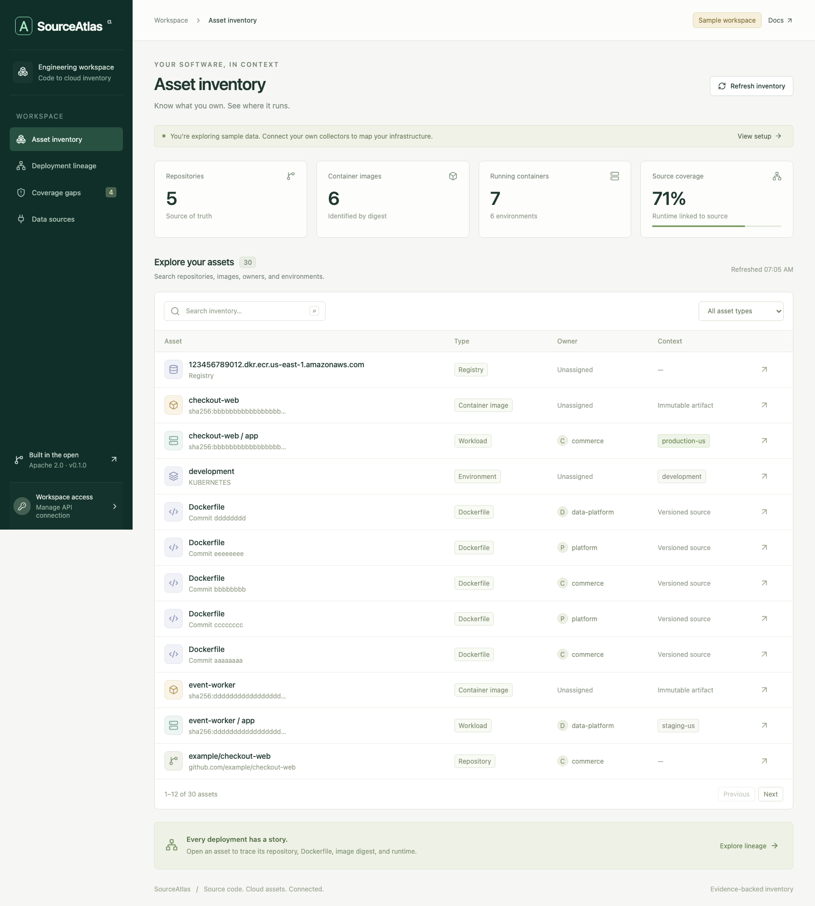

<div align="center">

# SourceAtlas

**Know where your source code runs.**

Open-source asset inventory that connects repositories and Dockerfiles to immutable container images and running Kubernetes or ECS workloads.

[](https://github.com/quentinmayo/sourceatlas/actions/workflows/ci.yml)
[](LICENSE)

</div>

```text
Repository → Dockerfile @ commit → ECR image @ sha256 → Running container → Environment
                                       ↑
                              CI provenance + runtime evidence
```

**“Where is this Dockerfile deployed?”** Search for the repository or Dockerfile, then open deployment lineage. SourceAtlas joins CI build evidence with runtime-reported image digests, so you can identify deployments and their owners without guessing from mutable tags.

SourceAtlas takes inspiration from [Qualys Global AssetView](https://www.qualys.com/apps/global-assetview), [Backstage's software catalog](https://backstage.io/docs/features/software-catalog/), and [Wiz's code-to-cloud security graph](https://www.wiz.io/). It is an independent project, with no affiliation. This first release is an inventory and source-attribution foundation, not a complete CNAPP or vulnerability scanner.

## What works today

- Searchable inventory of repositories, versioned Dockerfiles, images, registries, running containers, and environments.
- Interactive lineage in both directions, including one source image running in multiple environments.
- GraphQL API backed by **Neo4j**, with native asset nodes and evidence-bearing relationships. GraphQL is the API language; Neo4j is the graph database.
- CI build-manifest ingestion, ECR discovery, live Kubernetes collection through `kubectl`, and ECS running-task discovery through the AWS SDK.
- Explicit gaps for missing build provenance, unresolved runtime digests, missing ownership, and observations older than 24 hours.
- Idempotent ingestion, atomic workload snapshot reconciliation, stale-snapshot rejection, reader/collector tokens, and a runnable demo with synthetic data.



## Try it in two minutes

Requires Node.js 24+.

```sh
git clone https://github.com/quentinmayo/sourceatlas.git
cd sourceatlas
npm ci
npm run build
npm run demo
```

Open **http://127.0.0.1:4000**. The sample workspace is clearly labeled, uses in-memory data, and resets when the process exits. Demo mode does not enable ingestion unless you explicitly supply a `WRITE_TOKEN`.

For UI development, keep the demo/API running and run `npm run dev` in a second terminal. Vite serves the UI at http://127.0.0.1:5173 and proxies GraphQL to port 4000.

## Run your own inventory

Requires Docker Compose.

```sh
cp .env.example .env
# Replace NEO4J_PASSWORD, READ_TOKEN, and WRITE_TOKEN with distinct random secrets.
# For example, generate each with: openssl rand -hex 32
docker compose up --build -d
```

Open http://127.0.0.1:4000, choose **Workspace access**, and enter `READ_TOKEN`. The browser holds the token only in memory. Neo4j stores data in the `neo4j-data` volume; normal container restarts preserve it. `docker compose down -v` deletes that inventory.

The supplied configuration binds both app and database ports to localhost. For shared access, put the app behind HTTPS and your organization's identity-aware reverse proxy. The initial authorization model has one workspace and two static token roles: reader and collector. SSO, per-user RBAC, tenancy, and an audit log are future work. Do not expose Neo4j directly to the Internet.

Alternatively, run only `docker compose up -d neo4j`, then `npm run build && npm start`. The Node process loads `.env`. It refuses live mode without database credentials and distinct reader/writer tokens of at least 24 characters.

## Connect source to runtime

1. After pushing an image in CI, record its immutable digest and source commit in a [build manifest](examples/build.json). Submit one manifest per resulting artifact digest.
2. Collect registry metadata from ECR.
3. Collect running containers from Kubernetes or ECS.
4. Search a repository in the UI and select **Trace** to inspect its deployment lineage.

```sh
# npm collector commands load .env automatically.
# SOURCEATLAS_URL is the /graphql endpoint; WRITE_TOKEN authenticates ingestion.
npm run collect -- import --file examples/build.json --send
npm run collect -- ecr --region us-east-1 --send
npm run collect -- kubernetes --context prod-us --cluster prod-us --environment production --send
npm run collect -- ecs --region us-east-1 --environment production --send
```

Without `--send`, collectors write newline-delimited JSON batches to stdout and make no inventory changes. AWS discovery still performs read-only API calls. To experiment offline with synthetic observations:

```sh
npm run collect -- kubernetes --file examples/pods.json --cluster example-cluster --environment production --send
```

The example build and pod refer to the same digest. For real builds, replace the example repository, commit, Dockerfile, image, and timestamps. Ownership comes from the manifest's `owner` or the Kubernetes `sourceatlas.io/owner` label. ECS ownership can be inferred through its linked build.

See [collector setup and permissions](docs/collectors.md) and the [CI provenance script](examples/publish-build.mjs).

## Query the graph

Send this query to `/graphql` with `Authorization: Bearer <READ_TOKEN>`:

```graphql
query FindSource {
  assets(type: REPOSITORY, search: "payments", limit: 20) {
    total
    items {
      id
      name
      repository
      owner
    }
  }
}
```

Use an asset ID from the response:

```graphql
query TraceDeployment($id: ID!) {
  lineage(id: $id) {
    assets {
      id
      type
      name
      repository
      revision
      dockerfile
      image
      digest
      platform
      environment
    }
    links {
      source
      target
      type
      evidence
      observedAt
    }
  }
}
```

`assets` supports `search`, `type`, `environment`, `offset`, and `limit` (maximum 500). The environment filter applies to assets with an explicit environment, primarily workloads and environment nodes. `summary` provides counts and source coverage. `findings` returns visibility gaps. `ingest(batch: BatchInput!)` requires a collector token. The interactive GraphiQL explorer is available at `/graphql` in demo mode only.

## Evidence and limits

- Attribution requires **registry/repository + immutable SHA-256 digest**. Matching tags or repository names alone never establishes a link.
- CI manifests are assertions from an authorized collector, not cryptographically verified attestations. Signature verification and SLSA/in-toto support are planned.
- Multi-architecture index digests and platform-specific child digests are different identities. Submit provenance for the child digest reported by the runtime; automatic index-to-manifest resolution is not implemented.
- Kubernetes collects running regular containers from running Pods; init/ephemeral containers, stopped workloads, and deployment-controller aggregation are not included. ECS collects running task containers, not desired task definitions.
- Complete workload snapshots replace only their own stable collector scope. Failed or partial scans must never be submitted as complete. If a collector stops running, observations remain but become stale after 24 hours.
- ECR images and build evidence are retained historically. Registry deletions, disappeared clusters, retention policies, and scheduled collection are not automated. Rerun collectors on your preferred scheduler; no background discovery is implied.
- This MVP materializes graph reads in the API process, with limits of 20,000 assets and 100,000 relationships. It is intended for small inventories; indexed, paginated database-side traversals are a next scaling step.
- Request bodies are limited to 2 MB. A runtime snapshot is limited to 5,000 containers and is submitted atomically. Bigger clusters require future chunked snapshot sessions. Query depth is limited to 10 and documents to 300 fields; named fragments are disabled in this first release.

## Development and validation

```sh
npm ci
npm run build
npm test
npx playwright install chromium
npm run test:e2e
```

The browser tests cover inventory search, filters, lineage, visibility gaps, and mobile layout. API tests cover identity, digest matching, reconciliation, stale data, validation, and authorization.

For a real persistence test, create a **disposable, empty** database on the test-only port:

```sh
docker run -d --name sourceatlas-test-neo4j \
  -p 127.0.0.1:17687:7687 \
  -e NEO4J_AUTH=neo4j/sourceatlas-test-password neo4j:5.26-community
# Wait for the database to finish starting, then:
npm run test:neo4j
docker rm -f sourceatlas-test-neo4j
```

The integration test refuses other ports, checks the database is empty, and cleans up its fixtures. It tests native persistence across reconnection and transaction rollback. CI runs it against a disposable service.

## Roadmap

- Signed build attestations, SBOMs, OCI index resolution, and image replication relationships.
- GitHub App discovery, CODEOWNERS, and Backstage catalog import.
- Scheduled collectors with explicit freshness, scan status, and deletions.
- Kubernetes controllers, ECS services, cloud account inventory, and infrastructure-as-code links.
- Vulnerability ingestion, exposure context, and impact analysis using the source-to-runtime graph.
- SSO, granular RBAC, auditing, scalable graph traversals, and snapshot history.

See [architecture](docs/architecture.md), [contributing](CONTRIBUTING.md), and [security](SECURITY.md).

## License

[Apache License 2.0](LICENSE). Copyright 2026 Quentin Mayo and SourceAtlas contributors.
