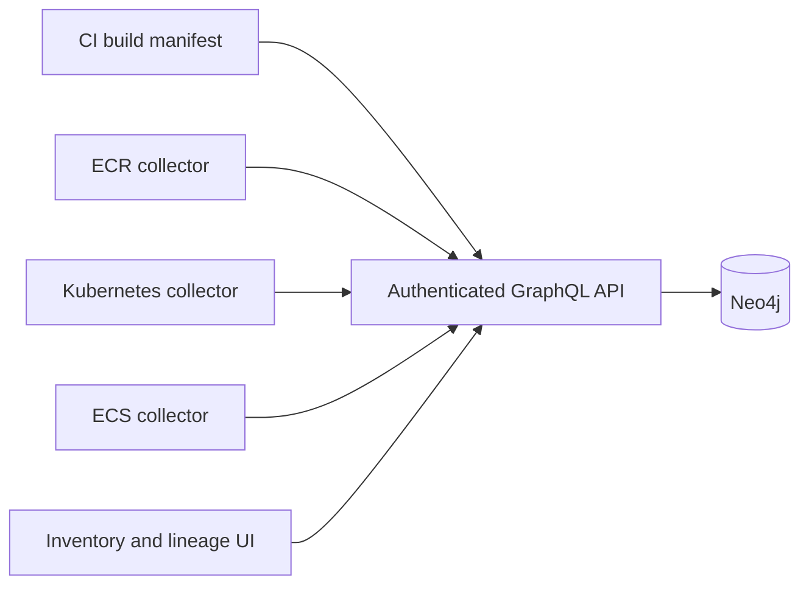

# Architecture

SourceAtlas is a single-workspace TypeScript application: a React/Vite UI, a GraphQL Yoga API, a Neo4j graph store, and standalone collectors. There is no dependency on a proprietary hosted service.

## Identity

IDs are SHA-256 hashes of JSON-encoded tuples. This avoids ambiguous concatenation and makes replay idempotent.

| Entity      | Identity                                                                   |
| ----------- | -------------------------------------------------------------------------- |
| Repository  | Normalized HTTP(S) repository URL, with trailing slash and `.git` removed  |
| Dockerfile  | Repository URL + full commit SHA + path                                    |
| Image       | Registry-qualified repository + immutable digest                           |
| Registry    | Registry hostname, including a port if present                             |
| Workload    | Stable collector scope + Pod UID/container name or task ARN/container name |
| Environment | Platform + configured environment name                                     |

Repository URL aliases are not resolved. Use the same canonical URL across build producers. Environment names intentionally aggregate workloads across clusters; collector scope still distinguishes workloads. Rebuilt source can point to multiple images. The same image can point to multiple workloads.

## Storage

Neo4j persists `Asset` nodes with a unique `id`, and `RELATES` relationships with an application-level `type`, evidence, timestamps, and stable ID. Relationship types are `CONTAINS`, `BUILT_AS`, `STORED_IN`, `DEPLOYED_AS`, and `RUNS_IN`. `Snapshot` nodes track per-kind/per-scope collection time. All Cypher values are parameters. Schema labels are fixed constants.

Ingestion validates an entire batch before a transaction. A write lock on the scope marker serializes concurrent snapshots from the same collector. Older snapshots fail without partial writes. Workload updates remove previous runtime edges; complete snapshots also delete absent workload nodes in that scope. Build, image, registry, and environment nodes are retained. Repeated identical observations leave the same logical graph.

An in-memory store implements the same contract for the demo and fast tests. It is not a persistence option for live inventory.

## Attribution

Source evidence comes from CI assertions containing the actual digest returned by the image build/push. Runtime evidence comes from Kubernetes container status or ECS container image digests. SourceAtlas never infers running provenance from desired manifests or mutable tags.

Lineage walks upstream and downstream independently from the selected asset. Registry and environment nodes are terminal context, preventing a trace from accidentally pulling in every unrelated asset sharing a registry or environment. Selecting a registry or environment explicitly expands its upstream lineage.

## Trust boundaries

The API requires reader or collector tokens in live mode. Only the collector token can mutate the graph. Tokens use constant-time comparison, and browsers store a reader token in memory. Tokens currently apply to the entire workspace. Collectors should run within the user's own CI/cloud boundary using narrowly scoped credentials. The API never stores AWS credentials.

Collector evidence is trusted input from token holders, not verified proof of a build. Restrict who can submit provenance. A future attestation verifier should establish builder identity, signature trust, and subject digest before marking evidence as verified. Current UI wording describes observations without claiming cryptographic verification.

Production deployments need HTTPS, organizational authentication, secret rotation, backups, and an appropriate network boundary. The included deployment binds locally for initial evaluation. GraphQL requests have body and structural bounds but no per-user quotas; add rate limiting at the reverse proxy for shared deployments.

## Known implementation boundaries

Graph reads currently retrieve the bounded inventory into the API process and cache that snapshot only for the current request. UI asset pages are limited; lineage and findings work over that bounded graph. Large installations need server-side indexed traversal, query cost controls, and streaming snapshot sessions. Runtime observation is point-in-time and can be incomplete due to cloud eventual consistency; stale evidence is surfaced, not silently treated as verified current state.
